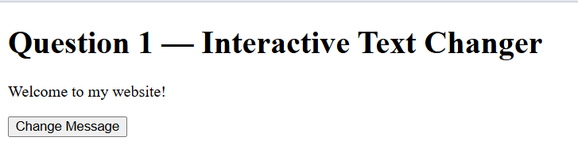
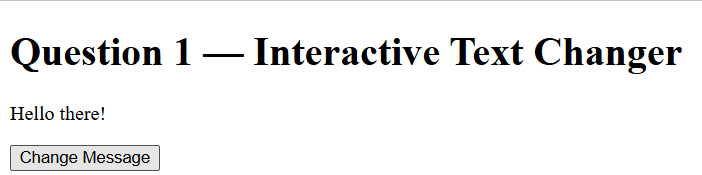
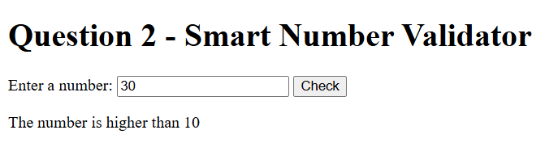
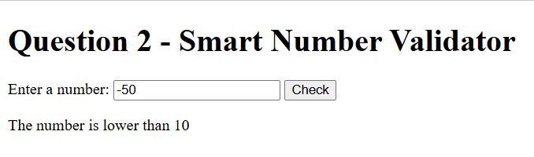
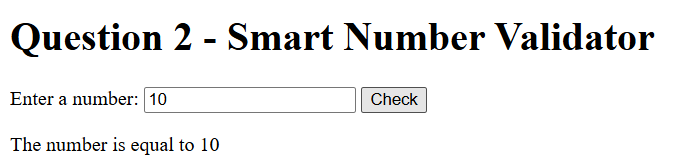
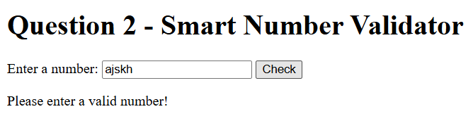
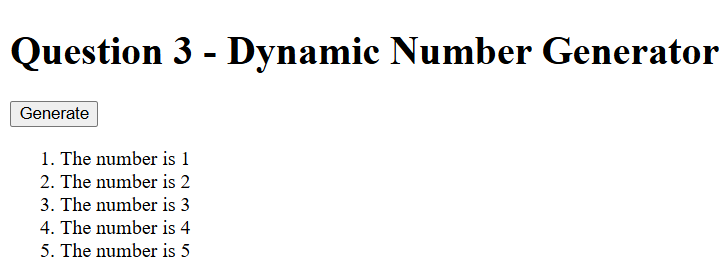

BIC21203 Lab 4a: Client-Side Scripting (JavaScript)

Name: TAN YEONG SHEN
Student ID: AI240186

Explanation:
This repository contains the solutions for Lab 4a on client-side JavaScript. Each question is placed in its own folder (Q1, Q2, and Q3) with an index.html file and an external script.js file loaded using the defer attribute.

In Question 1 (Interactive Text Changer), the script selects the paragraph and button elements using document.getElementById(). It defines the changeMessage() function to update the paragraph's textContent to "Hello there!" when the button is clicked via addEventListener().

In Question 2 (Smart Number Validator), the checkInput() function reads and trims the user's input from the text field, converts it using Number(), and checks whether it is a valid finite number. Using an if...else if...else structure, it displays whether the number is lower than 10, higher than 10, equal to 10, or invalid ("Please enter a valid number!") inside the result paragraph using textContent.

In Question 3 (Dynamic Number Generator), the generateNumbers() function first clears any existing list items in the ordered list so repeated clicks do not create duplicates. It then uses a for loop from 1 to 5 to create five new list item elements with document.createElement("li"), sets their textContent to "The number is 1" through "The number is 5", and appends each item to the ordered list.

Instructions to Run:
1. Open Q1/index.html in a web browser and click the "Change Message" button to see the text change.
2. Open Q2/index.html in a web browser, type a value (such as 5, 10, 15, 10.5, abc, or leave it blank), and click the "Check" button to view the validation message.
3. Open Q3/index.html in a web browser and click the "Generate" button to display the numbered list from 1 to 5.

Screenshots of Outputs:
Q1

Q2

Q3

Short Reflection:
Through this lab, I learned how to connect external JavaScript files to HTML documents using the defer attribute and handle user interactions cleanly with addEventListener() instead of inline onclick attributes. While completing Question 2, I learned the importance of trimming input strings before converting them with Number() so that empty or whitespace-only inputs are properly caught as invalid rather than being evaluated as zero. In Questions 1 and 3, using textContent and document.createElement() showed me how to update and create DOM elements safely without using innerHTML. Overall, this lab improved my practical understanding of DOM selection, event listeners, conditional input validation, and for loops in JavaScript.
